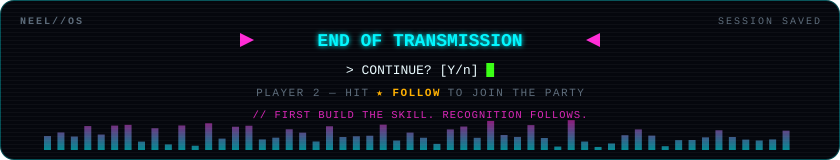

<!-- ╔══════════════════════════════════════════════════════════════════════╗ -->
<!-- ║  NEEL//OS · github.com/neelstar8                                     ║ -->
<!-- ║  Animated art lives in /assets — edit tools/build_assets.py & rerun   ║ -->
<!-- ╚══════════════════════════════════════════════════════════════════════╝ -->

<div align="center">



<a href="https://www.linkedin.com/in/neel-gadekar-018248243"></a>
<a href="mailto:neelgadekar9@gmail.com"></a>
<a href="https://github.com/neelstar8?tab=followers"></a>
<a href="https://www.instagram.com/neel.ae"></a>

<br/>

<a href="#player"><kbd> 👾 PLAYER </kbd></a>&nbsp;
<a href="#quests"><kbd> ⚔️ QUESTS </kbd></a>&nbsp;
<a href="#missions"><kbd> 🚀 MISSIONS </kbd></a>&nbsp;
<a href="#skills"><kbd> 🧬 SKILL TREE </kbd></a>&nbsp;
<a href="#achievements"><kbd> 🏆 ACHIEVEMENTS </kbd></a>&nbsp;
<a href="#telemetry"><kbd> 📡 TELEMETRY </kbd></a>

</div>

<br/>



> [!TIP]
> **🛰️ STATUS — OPEN TO SUMMER 2027 INTERNSHIPS** · SDE · AI/ML · GenAI · Full-Stack<br/>
> B.Tech Computer Engineering @ K.J. Somaiya College of Engineering · graduating **May 2028** · ping → **neelgadekar9@gmail.com**


<a name="player"></a>

## `0x01` · 👾 PLAYER CARD



```yaml
# ~/saves/neel.sav — autosaved
player:       Neel Gadekar
class:        AI Engineer             # + GenAI Builder · Full-Stack · Android · Web3
guild:        K.J. Somaiya College of Engineering — B.Tech Computer Engineering (2025 → 2028)
origin:       Vidyalankar Polytechnic — Diploma in IT (2023 → 2025)
stats:        { cgpa: 9.08, diploma: 90.88% }
main_quest:   KJ GPT                  # RAG-powered AI platform for KJSCE students
learning:     [Agentic AI, MCP, LangGraph, Local LLMs, Kubernetes]
languages:    [English, Hindi, Marathi, Japanese]
looking_for:  Summer 2027 internship  # SDE · AI/ML · GenAI
motto:        "First build the skill. Recognition follows."
```


<a name="quests"></a>

## `0x02` · ⚔️ QUEST LOG



```diff
@@ ACTIVE QUEST @@
+ AI Intern · CodeAlpha (Remote) ·································· NOW
#   ▸ Built an FAQ chatbot — NLP intent matching via tokenization + cosine similarity
#   ▸ Developed a language-translation tool on top of external translation APIs
#   ▸ NLP with NLTK / spaCy · tested & fine-tuned models for accuracy and response quality
#   ▸ Documented workflows, datasets and model outputs for future NLP experiments

@@ QUESTS CLEARED @@
+ Blockchain Intern · On-Campus Internship ················· MAR 2026 → JUL 2026
#   ▸ Smart contracts with Ethereum tooling · basic DApps · Web3 transaction handling
#   ▸ Consensus mechanisms & gas optimization · debugged contracts on public testnets

+ Android Developer Intern ································· MAY 2024 → JUL 2024
#   ▸ Java + Firebase apps with real-time data · auth, database integration, UI optimization
#   ▸ Cross-device performance debugging with senior devs · code reviews · Git workflows

@@ ACADEMIC CAMPAIGN @@
+ B.Tech Computer Engineering · K.J. Somaiya College of Engineering · 2025 → 2028 · CGPA 9.08
+ Diploma in Information Technology · Vidyalankar Polytechnic ······ 2023 → 2025 · 90.88%
```


<a name="missions"></a>

## `0x03` · 🚀 MISSIONS

<table>
<tr>
<td width="50%" valign="top">

### 🤖 [KJ GPT](https://github.com/neelstar8?tab=repositories&q=gpt)
`MAIN QUEST` `LEGENDARY`

Full-stack AI platform for K.J. Somaiya students — context-aware help across notes, PYQs, timetables, faculty info and announcements, in one place.

**🎁 Loot:** RAG chatbot · semantic search over study resources · AI resume builder · AI mock interviews with feedback · internship finder · placement hub · faculty appointment booking · smart notifications · personal dashboard

&nbsp; `Gemini` `RAG` `Pinecone`

</td>
<td width="50%" valign="top">

### 📈 [Automated Trading Extension](https://github.com/neelstar8?tab=repositories&q=trade)
`EPIC` `AUTOMATION`

Chrome extension that reads market trend, volume confirmation and price action, then places and manages trades on predefined strategy rules — fast, emotion-free execution with no manual monitoring.

**🎁 Loot:** 💰 **$5,000+** in trading profits · more consistent, faster execution

`Chrome Extension` `Strategy Rules` `Automation`

</td>
</tr>
</table>

**🗺️ SIDE QUESTS**

| Quest | Intel | Quest | Intel |
|:--|:--|:--|:--|
| 🏥 [**SwasthyaSetu**](https://github.com/neelstar8?tab=repositories&q=swasthya) | AI + Blockchain hospital management | 📑 [**CA Chacha**](https://github.com/neelstar8?tab=repositories&q=chacha) | AI tax assistant |
| 📱 [**FaceVault AI**](https://github.com/neelstar8?tab=repositories&q=facevault) | Smart face authentication | 📄 [**AI Resume Scanner**](https://github.com/neelstar8?tab=repositories&q=resume) | AI resume analysis |
| 📊 [**Trade Analyzer**](https://github.com/neelstar8?tab=repositories&q=trade) | AI-powered market insights | 🧾 [**QR Attendance**](https://github.com/neelstar8?tab=repositories&q=attendance) | QR-code attendance tracking |
| 🌊 [**Suraksha Coast**](https://github.com/neelstar8?tab=repositories&q=suraksha) | Coastal safety platform | 🔍 [**Code Guard**](https://github.com/neelstar8?tab=repositories&q=guard) | AI plagiarism detection |


<a name="skills"></a>

## `0x04` · 🧬 SKILL TREE

```text
NEEL//SKILL_TREE ─────────────────────────────────────── [ status: always leveling ]

◈ AI · ML · GENAI
 ├─ llm ......... LLMs · RAG · Prompt Engineering · Fine-Tuning (PEFT · LoRA)
 ├─ agents ...... LangChain · LangGraph · OpenAI · Gemini · Ollama · Hugging Face
 ├─ vectors ..... Pinecone · FAISS · Vector Embeddings
 ├─ vision ...... Computer Vision · YOLOv8 · OCR · TensorFlow Lite · ML Kit
 ├─ core ........ Machine Learning · Deep Learning · NLP (NLTK · spaCy)
 └─ data-sci .... Scikit-learn · Pandas · NumPy · Matplotlib

◈ FULL-STACK
 ├─ frontend .... React · Next.js · HTML · CSS · Tailwind CSS
 ├─ backend ..... Node.js · Express.js · REST APIs
 └─ data ........ PostgreSQL · MongoDB · SQLite · DynamoDB · Firebase · Supabase

◈ MOBILE ........ Android (Java · XML) · Firebase
◈ WEB3 .......... Smart Contracts · Ethereum · Hyperledger (basics)
◈ CLOUD/OPS ..... AWS (EC2 · S3) · Microsoft Azure · Docker · GitHub Actions · Ubuntu Linux
◈ LANGUAGES ..... Java · Python · C/C++ · JavaScript · TypeScript · SQL
```

<p align="center"><b>⚙️ LOADOUT</b></p>

<p align="center">
  <br/>
  <br/>
  <br/>
  
</p>


<a name="achievements"></a>

## `0x05` · 🏆 ACHIEVEMENTS UNLOCKED

| | Achievement | Unlocked via |
|:--:|:--|:--|
| 🎓 | **CGPA 9.08** | B.Tech Computer Engineering · KJSCE |
| 🥇 | **90.88%** | Diploma in Information Technology · Vidyalankar Polytechnic |
| ☁️ | **Microsoft Certified: Azure Fundamentals** | Microsoft |
| 🤖 | **Claude & AI Fundamentals** | Anthropic |
| ⚔️ | **3 internships** | AI (CodeAlpha) · Blockchain · Android |
| 💰 | **$5,000+ automated trading profit** | Automated Trading Chrome Extension |

<p align="center">
  
</p>

### 🎯 CURRENT OBJECTIVES

- [x] Build **KJ GPT** — RAG-powered AI platform for KJSCE students
- [x] Unlock **Microsoft Certified: Azure Fundamentals**
- [x] Add **LangGraph** to the arsenal
- [ ] **Land a Summer 2027 internship** ← *active quest*
- [ ] Ship production AI agents · master MCP + agentic workflows
- [ ] Build local-LLM applications
- [ ] Publish Android apps on the Play Store
- [ ] Deploy AI at scale · contribute more to open source


<a name="telemetry"></a>

## `0x06` · 📡 TELEMETRY

<div align="center">


<picture>
  <source media="(prefers-color-scheme: dark)" srcset="https://raw.githubusercontent.com/neelstar8/neelstar8/output/github-snake-neon.svg"/>
  <source media="(prefers-color-scheme: light)" srcset="https://raw.githubusercontent.com/neelstar8/neelstar8/output/github-snake.svg"/>
  
</picture>

</div>

<details>
<summary><b>🔒 CLASSIFIED — click to decrypt</b></summary>
<br/>

```diff
+ DECRYPTION SUCCESSFUL ▸ ACHIEVEMENT UNLOCKED: "CURIOUS EXPLORER" 🕵️
! You scrolled all the way down. That's the same energy I bring to a codebase.
#   ▸ Recruiters: put "NEEL//OS" in your email subject — I'll know you found this.
#   ▸ Builders: AI agents, RAG apps, Android, Web3 — let's ship something weird and useful.
```

</details>

<div align="center">




</div>
